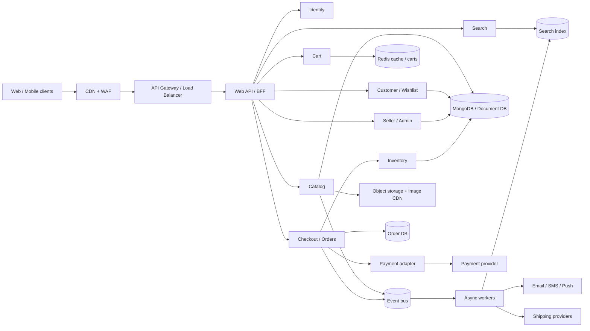

# Flipkart-Style Marketplace System Design

This design describes a large, multi-seller e-commerce marketplace. It is a reference architecture, not a description of Flipkart's private infrastructure. The repository today is a React/Vite client with an Express/Node API, MongoDB/Mongoose, Stripe, and Cloudinary; the design below shows how to evolve that foundation.

## 1. Goals and scope

### Customer features

- Browse categories, search, filter, and view product details.
- Manage accounts, addresses, wishlists, and carts across devices.
- Place and pay for orders, track shipments, cancel eligible items, and request returns/refunds.
- See reviews, offers, recommendations, and delivery estimates.

### Marketplace features

- Seller onboarding, catalog and inventory management, pricing, and order fulfillment.
- Admin moderation, customer support, promotions, and operational reporting.

### Quality goals

- Keep browsing available during partial downstream outages.
- Protect checkout from duplicate orders and overselling.
- Scale read-heavy catalog and search traffic independently from order writes.
- Track all money and inventory changes with auditable records.

## 2. High-level architecture



At the current project's size, implement these as modules inside the existing Express application first. Split high-load or independently operated modules into services only when traffic, deployment needs, or team ownership justify it. Keep clear module boundaries from the start.

## 3. Core components

| Component | Responsibilities | Suggested storage / technology |
|---|---|---|
| Web client | Product discovery, cart, checkout, account and seller screens | Existing React + Vite |
| API gateway / BFF | Authentication checks, request shaping, rate limits, API versioning | Existing Express API initially |
| Identity | Registration, login, sessions/tokens, roles, account recovery | MongoDB; password hashing; short-lived access tokens |
| Catalog | Products, variants, categories, seller offers, attributes, media metadata | MongoDB; images in Cloudinary/object storage |
| Search | Text search, facets, sorting, autocomplete | OpenSearch/Elasticsearch index fed asynchronously |
| Cart | User and guest carts, quantity edits, price snapshots | Redis for active carts; durable cart optional |
| Inventory | Per-seller, per-warehouse stock; reservations and releases | MongoDB transactions or relational store with atomic updates |
| Checkout / Orders | Price validation, order creation, state transitions, idempotency | Durable order database; append-only event/audit history |
| Payments | Provider integration, payment intents, webhooks, refunds | Stripe or local provider; never store card data |
| Fulfillment | Shipment creation, tracking, delivery and return status | Provider adapters + order events |
| Notifications | Order, payment, shipment and account messages | Queue-backed workers |
| Seller / Admin | Listings, stock, order processing, moderation, reports | Role-protected API modules |

## 4. Important data entities

- **User**: `id`, profile, verified contacts, password hash, roles, status.
- **Address**: `id`, `userId`, encrypted/controlled PII fields, delivery instructions.
- **Product**: `id`, title, description, category, attributes, media, status.
- **SellerOffer**: `id`, `productId`, `sellerId`, price, currency, condition, fulfillment option, active status. A product can have multiple seller offers.
- **Inventory**: `offerId`, `warehouseId`, `available`, `reserved`, `version`. Keep stock separate from product descriptions.
- **Cart**: `userId` or guest token, offer IDs, quantities, updated time. Recalculate all prices at checkout.
- **Order**: `id`, `userId`, item snapshots, address snapshot, totals, payment status, fulfillment status, idempotency key, timestamps.
- **OrderItem**: offer/product/seller IDs, SKU, title and price snapshots, quantity, tax/discount allocation, item status.
- **Payment**: `orderId`, provider reference, amount, currency, status, idempotency key, webhook event IDs.
- **InventoryReservation**: `orderId`, `offerId`, quantity, expiry, state. Supports release after failed or expired payment.
- **OutboxEvent**: event ID, aggregate ID, type, payload, created time, published time. Stored with the transaction that changes business state.

Store money as integer minor units (for example paise), with an explicit currency. Record order snapshots so later product or price edits do not change historical orders.

## 5. Key flows

### Browse and search

1. Client requests a category, search result, or product detail through the BFF.
2. Catalog reads cacheable product/offer data; CDN serves images.
3. Search queries the search index for text and facets. Results include IDs and ranking; the catalog supplies current offer/availability details.
4. Catalog changes emit events. A worker updates the search index; search may be briefly stale, while checkout always revalidates price and stock against authoritative stores.

### Checkout and payment

1. Client sends cart, address, and an idempotency key to checkout.
2. Server authenticates the user, reloads offers/prices, validates promotions and delivery eligibility, and computes the total. Never trust client totals.
3. Reserve stock atomically with a short expiry. If any item cannot be reserved, release prior reservations and return an item-level availability error.
4. Create a pending order and payment intent. Use an idempotency key for both order creation and provider calls.
5. Confirm payment from the provider webhook, not from the browser redirect. Verify webhook signatures and deduplicate provider event IDs.
6. On confirmed payment, mark the order paid, commit reservations, and publish an `OrderPaid` event through a transactional outbox. Workers arrange fulfillment and send notifications.
7. On payment failure or reservation expiry, mark the attempt failed and release stock. A reconciliation worker repairs cases where a provider response or webhook was delayed.

### Returns and refunds

Represent each order item with its own fulfillment/return state. Validate the return window and policy, create a return authorization, receive/inspect the item as required, then request a provider refund. Keep refund state and provider references for reconciliation; do not infer a completed refund solely from a client request.

## 6. API outline

```text
GET    /api/v1/products?category=&q=&filters=&sort=&cursor=
GET    /api/v1/products/:productId
GET    /api/v1/offers/:offerId
GET    /api/v1/cart
PUT    /api/v1/cart/items/:offerId
DELETE /api/v1/cart/items/:offerId
POST   /api/v1/checkout                 (Idempotency-Key required)
GET    /api/v1/orders/:orderId
GET    /api/v1/orders                   (customer's own orders)
POST   /api/v1/orders/:orderId/cancel
POST   /api/v1/returns
POST   /api/v1/payments/webhook          (provider signature verified)
POST   /api/v1/seller/offers
PATCH  /api/v1/seller/inventory/:offerId
GET    /api/v1/seller/orders
```

Use cursor pagination for large lists, validate inputs at the API boundary, and authorize every object lookup (a customer must not fetch another customer's order by changing its ID).

## 7. Scaling and reliability

- **Cache**: CDN for static assets/images; Redis for hot catalog responses, sessions, and active carts. Use bounded TTLs and invalidate via events where practical. Do not use cache as the authority for payment or stock.

- **Database**: Index product category/status, seller ID, user ID + order date, order ID, offer ID, and payment provider reference. Use atomic conditional inventory updates. Add replicas for read scale; partition/shard only after measuring data volume and access patterns.
- **Async work**: Queue search indexing, notifications, image processing, and shipping updates. Use retries with backoff, dead-letter queues, event IDs, and idempotent consumers.
- **Checkout protection**: Rate-limit abuse, cap cart quantities, set reservation expiry, enforce idempotency, and reconcile payment/order states.
- **Availability**: Timeouts, bounded retries, circuit breakers for providers, health checks, and degraded browsing. Do not retry non-idempotent payment operations blindly.
- **Observability**: Structured logs with request/order correlation IDs; metrics for search latency, checkout conversion, payment failures, reservation conflicts, queue lag, and stock mismatches; traces across API and workers. Exclude secrets and payment data from logs.
- **Backups and recovery**: Automated database backups, tested restore procedures, and retention policies for audit and order data.

## 8. Security and privacy

- Enforce TLS, secure cookies or carefully managed tokens, CSRF protection where cookie auth is used, and rate limits on login and checkout.
- Hash passwords with a modern password hashing algorithm and per-user salts. Keep secrets in environment/secret management, never in source control.
- Apply role-based authorization for customer, seller, support, and admin actions. Audit privileged changes.
- Validate uploads, restrict file types/sizes, and keep media delivery separate from API execution.
- Minimize and protect personal data; apply retention and deletion rules. Use the payment provider's hosted/tokenized flow so card details do not enter the application.

## 9. Mapping to this repository

- `client/`: React/Vite user interface; keep API calls behind existing utilities and context.
- `backend/server.js`, `backend/routes/`, `backend/controllers/`: Express API and modular route/controller boundaries.
- `backend/models/`: current Mongoose entities for users, products, and orders. Add seller offers, inventory reservations, payments, and outbox models as the corresponding flows are built.
- `backend/services/flipkartAffiliate.js`: isolate external affiliate integration behind an adapter; treat its data as an external source, not as the source of truth for orders or stock.
- `backend/config/database.js`: MongoDB connection. Production should fail clearly when its configured database is unavailable; an in-memory fallback is useful for local development but must not silently receive production traffic.
- Stripe and Cloudinary integrations: keep provider secrets server-side, verify Stripe webhooks, and store provider IDs rather than sensitive payment data.

## 10. Practical implementation phases

1. **Harden the current app**: validation, consistent errors, access control, secrets, logging, indexes, and durable production database configuration.
2. **Make checkout correct**: server-side totals, idempotency, inventory reservation, payment webhooks, order state machine, and reconciliation.
3. **Improve discovery**: product/offer separation, pagination, cache, and a dedicated search index when catalog volume needs it.
4. **Support marketplace operations**: seller onboarding, per-seller stock and orders, returns/refunds, audit logs, and notifications.
5. **Scale selectively**: add queues and split services only around demonstrated bottlenecks or independent ownership needs.
