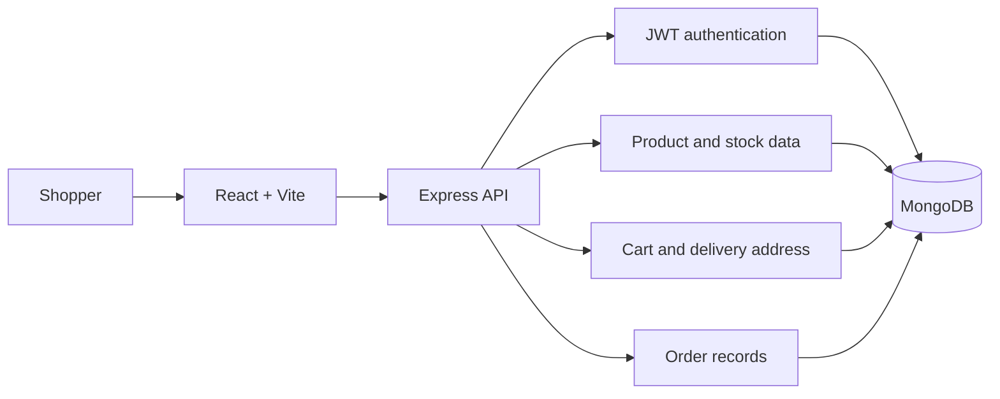

# Simple System Design

This project is a Flipkart-style shopping app built as one React frontend, one Express backend, and one MongoDB database. The checkout uses a fake payment simulation. It does not connect to a real payment provider or charge money.

## Main parts



- **React frontend:** product pages, cart, checkout, payment result, confirmation, and order history.
- **Express backend:** authenticates requests, validates checkout, and exposes the API routes.
- **MongoDB:** stores users, products, cart and address data, stock, and orders.

## Checkout flow

```mermaid
sequenceDiagram
    actor Shopper
    participant Web as React app
    participant API as Express API
    participant DB as MongoDB
    Shopper->>Web: Add products to cart
    Shopper->>Web: Enter delivery address and choose payment
    Web->>API: Submit payment simulation and checkout key
    API->>DB: Read cart, current prices, and stock
    API->>API: Calculate total and simulate result
    alt Payment succeeds or COD is selected
        API->>DB: Save confirmed order and update stock
        API->>DB: Clear purchased cart items
        API-->>Web: Return order details
        Web-->>Shopper: Show order confirmation
    else Simulated payment fails
        API->>DB: Save failed attempt; keep cart and stock
        API-->>Web: Return failed payment result
        Web-->>Shopper: Show retry option
    end
```

## Order and payment states

| Scenario | Payment status | Order status | Cart |
|---|---|---|---|
| Demo payment succeeds | `PAID` | `CONFIRMED` | Cleared after save |
| Demo payment fails | `FAILED` | `PAYMENT_FAILED` | Kept for retry |
| Cash on Delivery | `PENDING` | `CONFIRMED` | Cleared after save |

## Important rules

- The server reads product prices and stock from MongoDB. It does not trust prices sent by the browser.
- A checkout key prevents repeated clicks from creating duplicate orders.
- Stock changes only after success or COD, and the cart clears only after the order is saved.
- Order APIs require sign-in, and customers can only view their own orders.
- Never collect or save card numbers, CVV, UPI PIN, OTP, or bank passwords. The payment screen is a simulation.

## Main API routes

```text
GET  /api/v1/user/cart
PUT  /api/v1/user/shipping-info
POST /api/v1/user/payments/simulate
GET  /api/v1/user/orders
GET  /api/v1/user/orders/:id
```
